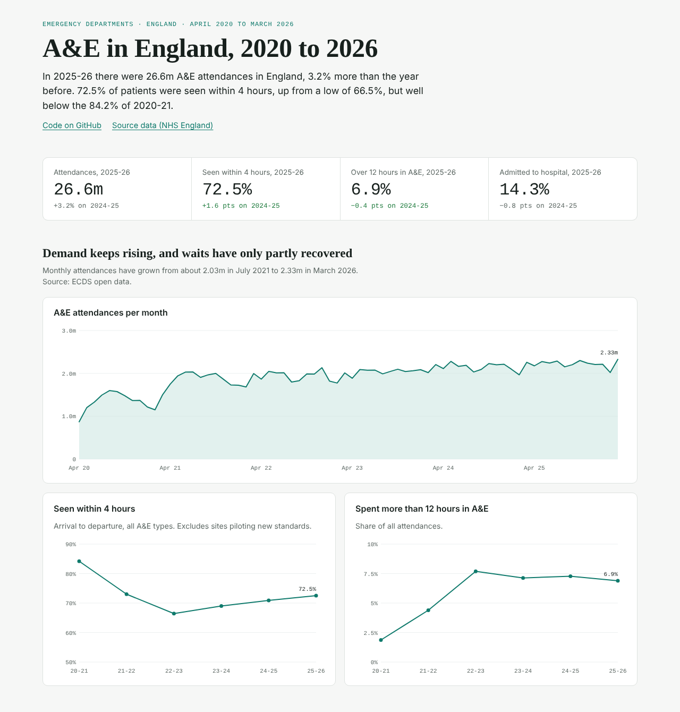
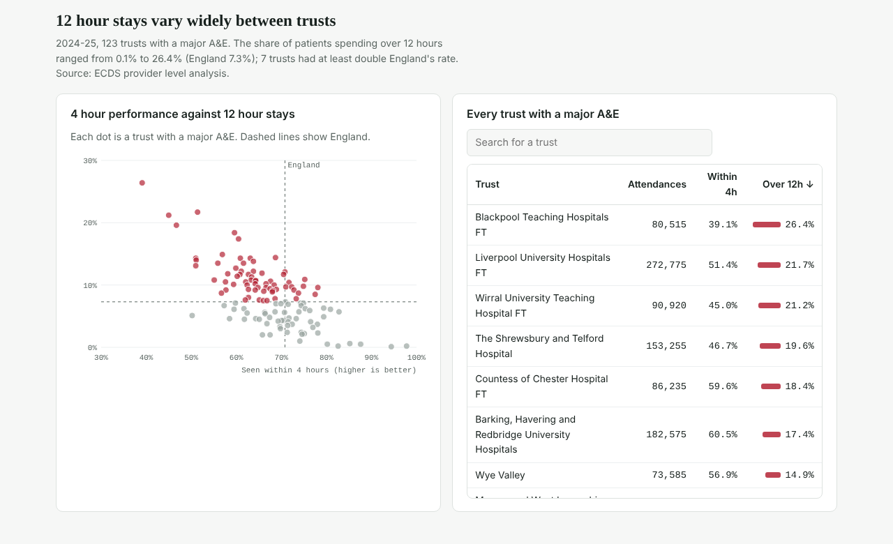

# NHS A&E Analytics

An independent analysis of NHS England's public A&E data, from data cleaning and testing through to a
published dashboard and an interactive app.

**Dashboard:** https://ifychukwu.github.io/nhs-ae-analytics/
**Live app:** _ https://nhs-ae-analytics-l7ywhuw5jw7wppnatnnuic.streamlit.app/

[](https://ifychukwu.github.io/nhs-ae-analytics/)

[](https://ifychukwu.github.io/nhs-ae-analytics/)

## What's here

| Folder | What it is |
| --- | --- |
| [`docs/`](docs/) | **A&E in England, 2020 to 2026**: the static dashboard above, served by GitHub Pages. One self-contained page with no external scripts. |
| [`app/`](app/) | **A&E Data Explorer**: a Streamlit app over six years of ECDS data (England monthly April 2020 to March 2026, plus trust level for 2023-24 and 2024-25), with plain-English questions answered by Claude through read-only SQL. |
| [`pipeline/`](pipeline/) | **A&E Pressure Monitor**: a tested Python pipeline for July to September 2026: 4 and 12 hour performance, a seasonal demand forecast, k-means segmentation of trusts and a deprivation analysis. |
| [`site/`](site/) | The script and template that build `docs/index.html` from the app's database and the pipeline's outputs. |

## Data quality findings

Every build runs data checks before anything is published. They caught three problems in the source data:

1. **Age rates in the 2025-26 publication do not match their own counts.** For example, 263,309
   attendances per 100,000 for ages 5 to 9, where 1,257,464 attendances over 3,311,011 people give 37,978.
   Earlier years use the 2024-25 publication, which is consistent, and 2025-26 rates are recalculated.
2. **2023-24 trust waiting times cover 94.3% of England's attendances**, so trusts are benchmarked
   against England built from the same trust rows rather than the published national figure.
3. **The 4 hour percentage excludes sites piloting new standards**, so it is calculated as within 4 hours
   ÷ (within + over 4 hours), matching NHS England's published 2024-25 figure (70.8% vs 70.9%).

## Rebuild the dashboard

```bash
pip install pandas
python site/build_site.py      # writes docs/index.html
```

To publish it: on GitHub go to **Settings → Pages**, set **Source** to *Deploy from a branch*, choose
branch `main` and folder `/docs`, and save. The page appears at `https://<your-username>.github.io/nhs-ae-analytics/`
within a few minutes. To show a link to the live app on the page, paste its address into `APP_URL`
near the top of the script in `site/template.html` and rebuild.

## Data source

NHS England, [Hospital Accident & Emergency Activity](https://digital.nhs.uk/data-and-information/publications/statistical/hospital-accident--emergency-activity)
(ECDS open data and provider level analysis) and
[A&E Attendances and Emergency Admissions](https://www.england.nhs.uk/statistics/statistical-work-areas/ae-waiting-times-and-activity/).
Open Government Licence v3.0. This is not an NHS England product.
